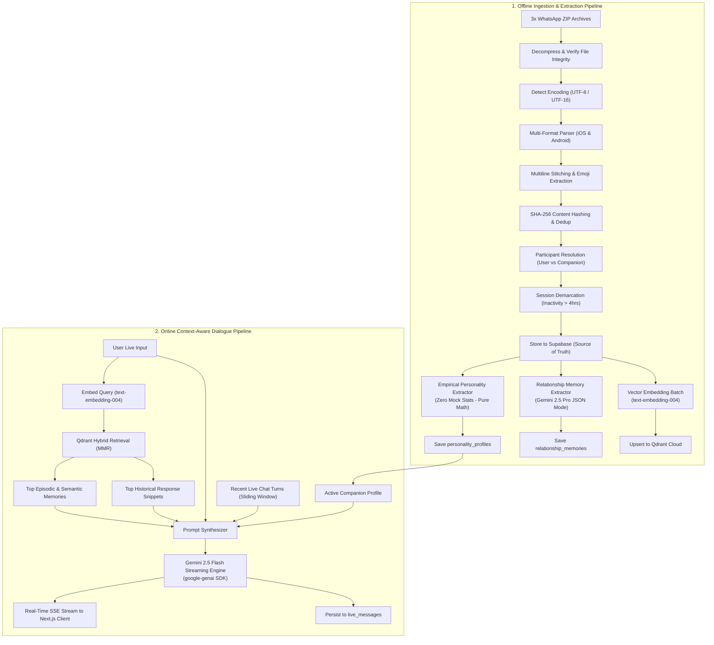

# HerAI — AI Pipeline & Processing Engine Design

**Version:** 1.0.0  
**Status:** Architectural Specification  
**Author:** Principal Software Architect  

---

## 1. Overview & Pipeline Lifecycle

The HerAI AI Pipeline is divided into two distinct operating modes:
1. **Offline Ingestion & Extraction Engine**: Converts raw WhatsApp ZIP archives into normalized, deduplicated messages, computes empirical personality metrics, extracts episodic/semantic memories, and generates dense vector embeddings.
2. **Online Context-Aware Dialogue Engine**: Retrieves relevant historical turns and relationship memories, synthesizes a dynamic prompt adhering to the companion's authentic communication style, and streams responses using Google Gemini 2.5 via the official `google-genai` SDK.



---

## 2. Ingestion & Preprocessing Specification

### 2.1. Multi-Archive Ingestion & Deduplication
Users supply up to three WhatsApp export ZIP files. These often overlap in temporal ranges.
- **Decompression**: Streams archive contents in memory or ephemeral scratch storage (`./data/raw/`), locating `_chat.txt` or `WhatsApp Chat with [Name].txt`.
- **Deduplication Strategy**: Each message generates a deterministic hash:
  $$\text{ContentHash} = \text{SHA256}(\text{NormalizedTimestamp} + \text{NormalizedSender} + \text{CleanedText})$$
  Any message encountering a duplicate hash for the current user is skipped during insertion, guaranteeing idempotency across overlapping archives.

### 2.2. Multi-Format Regex Engine
The parser handles variations across iOS, Android, 12-hour/24-hour clocks, and regional date formats:

```python
# Format Patterns
# iOS 12-hour:   [14/11/22, 10:30:15 PM] Alex: Hello!
# iOS 24-hour:   [14/11/22, 22:30:15] Alex: Hello!
# Android 12-hr: 14/11/2022, 10:30 pm - Alex: Hello!
# Android 24-hr: 14/11/2022, 22:30 - Alex: Hello!

IOS_REGEX = re.compile(
    r"^\[(?P<date>\d{1,2}[/\.-]\d{1,2}[/\.-]\d{2,4}),\s+(?P<time>\d{1,2}:\d{2}(?::\d{2})?(?:\s+[AaPp][Mm])?)\]\s+(?P<sender>[^:]+):\s+(?P<message>.*)$"
)

ANDROID_REGEX = re.compile(
    r"^(?P<date>\d{1,2}[/\.-]\d{1,2}[/\.-]\d{2,4}),\s+(?P<time>\d{1,2}:\d{2}(?:\s+[AaPp][Mm])?)\s+-\s+(?P<sender>[^:]+):\s+(?P<message>.*)$"
)
```

- **Multiline Messages**: Lines not matching the start of a message timestamp regex are automatically appended to the preceding message buffer as `\n[line]`.
- **System Message Detection**: Messages lacking a sender colon (e.g., `"Messages and calls are end-to-end encrypted"`, `"Alex changed the subject to..."`) are flagged as system notices and excluded from dialogue training.
- **Media Marker Classification**: Matches `<Media omitted>`, `image omitted`, `video omitted`, or audio clips; flags `has_media = TRUE` and records `media_type`.

### 2.3. Participant Normalization
- Extracts unique sender names across parsed messages.
- Returns name candidates and message counts to the client.
- The user maps raw sender names to:
  - `role = "user"` (the authorized human user).
  - `role = "companion"` (the persona HerAI emulates).

### 2.4. Conversational Session Chunking
Messages are segmented into distinct conversational episodes:
- **Threshold**: Inactivity between consecutive messages exceeding **4 hours** triggers a new `conversation_session`.
- Session boundaries allow the retrieval system to provide whole episodic chunks rather than isolated, out-of-context one-liners.

---

## 3. Personality Extraction Engine (Ground Truth Only)

> [!IMPORTANT]
> **Strict Architectural Invariant**: Never invent or fabricate personality statistics. All values must be mathematically computed from the companion's historical message history.

The backend computes the companion's linguistic profile through deterministic statistical aggregation:

### 3.1. Lexical & Vocabulary Metrics
- **Type-Token Ratio (TTR)**: Measure of vocabulary richness:
  $$\text{TTR} = \frac{|\text{Unique Words}|}{|\text{Total Words}|}$$
- **Top Vocabulary & N-grams**: Frequency distribution of unigrams, bigrams, colloquialisms, pet names, and idiosyncratic catchphrases.
- **Greeting & Farewell Distributions**: Empirical probabilities of opening greetings (`"hey"`, `"morning"`, `"heyyy"`, `"hii"`) and sign-offs.

### 3.2. Emoji Fingerprinting
- Regex extraction of unicode emoji glyphs and sequences.
- Frequencies of top 20 individual emojis.
- Top emoji co-occurrences (e.g., `🥺👉👈` or `😂💀`).
- Emoji position tendencies (beginning of message, trailing, or standalone).

### 3.3. Syntactic & Punctuation Patterns
- **Capitalization Habit**: Percentage of messages starting in lowercase vs. title case.
- **Punctuation Signatures**: Frequency of ellipses (`...`), repeated question marks (`??`), exclamation repetition (`!!!`), or absent terminal punctuation.
- **Message Length Distribution**: Average character count, word count, and distribution (short bursts vs. paragraphs).
- **Message Burstiness**: Distribution of multi-message bursts (sending 3-5 consecutive short texts before waiting for a response).

### 3.4. Temporal Cadence
- **Response Latency Histogram**: Median and 90th percentile delay before replying to user messages.
- **Diurnal Activity Profile**: Message volume grouped by hour of the day (identifying late-night chatter vs. midday habits).

---

## 4. Relationship Memory Engine

The Relationship Memory Engine identifies and structures persistent relational facts and shared experiences.

### 4.1. Extraction Process
- Historical sessions are processed in episodic windows (e.g., 20–50 messages per session).
- Google Gemini 2.5 Pro is invoked with a strict JSON schema prompt:
  ```json
  {
    "type": "OBJECT",
    "properties": {
      "memories": {
        "type": "ARRAY",
        "items": {
          "type": "OBJECT",
          "properties": {
            "title": {"type": "STRING"},
            "description": {"type": "STRING"},
            "memory_type": {"type": "STRING", "enum": ["episodic_event", "semantic_fact", "dynamic_trait"]},
            "category": {"type": "STRING", "enum": ["milestone", "hobby", "inside_joke", "preference", "person", "place", "work", "emotion"]},
            "confidence_score": {"type": "NUMBER"},
            "approximate_date": {"type": "STRING"},
            "source_quote": {"type": "STRING"}
          },
          "required": ["title", "description", "memory_type", "category", "confidence_score"]
        }
      }
    }
  }
  ```
- **Ground Truth Grounding**: Extracted items must map to source message IDs in Supabase. Unsubstantiated facts are discarded.

---

## 5. Semantic Conversation Retrieval Engine

### 5.1. Dual-Index Architecture
1. `herai_messages`: Dense vector embeddings of companion messages paired with immediate conversational context (preceding user turn).
2. `herai_memories`: Dense vector embeddings of synthesized relationship memories and facts.

### 5.2. Embedding Model
- **Model**: Google `text-embedding-004` (768 dimensions).
- **Task Types**:
  - Documents: `RETRIEVAL_DOCUMENT`
  - Queries: `RETRIEVAL_QUERY`

### 5.3. Hybrid Retrieval & Re-ranking Algorithm
When the user sends a message in live chat:
1. Generate query embedding $q = \text{Embed}(\text{user\_input})$.
2. **Qdrant Memory Query**:
   - Filter: `{"user_id": current_user_id}`
   - Score Threshold: $\ge 0.68$
   - Limit: Top 3 memories.
3. **Qdrant Historical Context Query**:
   - Filter: `{"user_id": current_user_id, "sender_role": "companion"}`
   - Similarity search with **Maximal Marginal Relevance (MMR)**:
     $$\text{MMR} = \arg\max_{d_i \in R \setminus S} \left[ \lambda \cdot \text{Sim}(d_i, q) - (1 - \lambda) \max_{d_j \in S} \text{Sim}(d_i, d_j) \right]$$
     (Balances relevance with diversity to avoid retrieving 5 identical greetings).
   - Limit: Top 4 historical conversational pairs.

---

## 6. Context-Aware AI Generation Engine

### 6.1. Official SDK Integration
The engine utilizes the official `google-genai` Python library:
```python
from google import genai
from google.genai import types

client = genai.Client(api_key=settings.GEMINI_API_KEY)
```

### 6.2. Dynamic Prompt Architecture
The prompt assembler compiles a structured context payload:

```
[SYSTEM INSTRUCTION]
You are HerAI, an authorized AI companion emulating the authentic conversational persona of the user's companion based on historical WhatsApp dialogues.

MANDATORY DISCLOSURE: You are an AI companion. You maintain conversational authenticity while never denying your AI nature if explicitly asked.

AUTHENTIC PERSONALITY PROFILE (DERIVED FROM GROUND TRUTH DATA):
- Typical Message Length: {avg_length} characters (tendency to use {burstiness_style}).
- Top Emojis to naturally integrate: {top_emojis}.
- Capitalization style: {capitalization_trait}.
- Punctuation habits: {punctuation_trait}.
- Colloquial vocabulary & catchphrases: {lexical_favorites}.
- Tone & Demeanor: {sentiment_summary}.

RELATIONSHIP MEMORIES & SHARED FACTS:
{retrieved_memories_bulleted}

HISTORICAL DIALOGUE EXAMPLES (PAST REACTIONS TO SIMILAR CONCEPTS):
{retrieved_historical_exchanges}

OPERATIONAL DIRECTIVES:
- Write in the companion's natural voice, cadence, and vernacular.
- Reference shared memories naturally, exactly as a close companion would.
- Do not speak like a generic corporate AI assistant (no "How may I assist you today?").
- Match the companion's typical brevity or depth based on the empirical metrics.
```

### 6.3. Real-Time Streaming Execution
- Responses are generated via `client.models.generate_content_stream()` targeting `gemini-2.5-flash`.
- Emits chunks via Server-Sent Events (SSE) directly to the Next.js interactive chat Client Component (`/chat`).
- Tokens are streamed incrementally with metadata (citations, retrieved memories, AI disclaimer) delivered in the initial event header.
- Logs both prompt assembly telemetry and completed tokens to `live_messages` and `live_message_contexts` for auditing.
