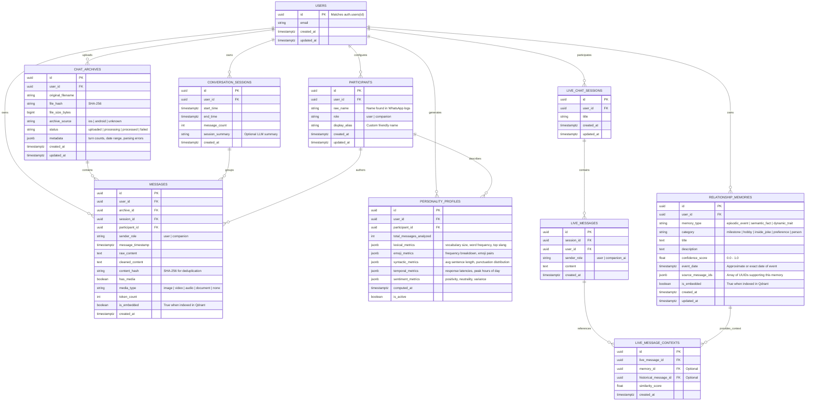

# HerAI — Database & Vector Store Design Document

**Version:** 2.0.0 (Updated for Next.js App Router & Supabase Migrations)  
**Status:** Architectural Specification  
**Author:** Principal Software Architect  

---

## 1. Relational Database Overview (Supabase PostgreSQL)

Supabase PostgreSQL is the primary, ACID-compliant source of truth. All user accounts, chat archives, parsed messages, conversational sessions, computed personality metrics, extracted relationship memories, and live interactions are durably stored here.

Database changes are managed via versioned **Supabase Migrations** (`supabase/migrations/`) executed through the Supabase CLI, ensuring reproducible schema deployments across environments.

FastAPI accesses PostgreSQL using **SQLAlchemy 2.0** ORM models (and asyncpg driver) for structured transactional operations, while enforcing PostgreSQL Row Level Security (RLS) bound to `auth.uid()`, guaranteeing that users can only read, insert, update, or delete data belonging strictly to their authenticated account.

---

## 2. Entity-Relationship (ER) Diagram



---

## 3. PostgreSQL DDL & Row Level Security (RLS)

```sql
-- Enable necessary extensions
CREATE EXTENSION IF NOT EXISTS "uuid-ossp";
CREATE EXTENSION IF NOT EXISTS "pgcrypto";

-- =============================================================================
-- 1. CHAT ARCHIVES TABLE
-- =============================================================================
CREATE TABLE public.chat_archives (
    id UUID PRIMARY KEY DEFAULT gen_random_uuid(),
    user_id UUID NOT NULL REFERENCES auth.users(id) ON DELETE CASCADE,
    original_filename TEXT NOT NULL,
    file_hash VARCHAR(64) NOT NULL,
    file_size_bytes BIGINT NOT NULL,
    archive_source VARCHAR(20) DEFAULT 'unknown' CHECK (archive_source IN ('ios', 'android', 'unknown')),
    status VARCHAR(20) DEFAULT 'uploaded' CHECK (status IN ('uploaded', 'processing', 'processed', 'failed')),
    metadata JSONB DEFAULT '{}'::jsonb,
    created_at TIMESTAMPTZ DEFAULT NOW(),
    updated_at TIMESTAMPTZ DEFAULT NOW(),
    CONSTRAINT uq_user_file_hash UNIQUE (user_id, file_hash)
);

ALTER TABLE public.chat_archives ENABLE ROW LEVEL SECURITY;

CREATE POLICY "Users can manage their own chat archives"
    ON public.chat_archives
    FOR ALL
    USING (auth.uid() = user_id)
    WITH CHECK (auth.uid() = user_id);

CREATE INDEX idx_chat_archives_user ON public.chat_archives(user_id);

-- =============================================================================
-- 2. PARTICIPANTS TABLE
-- =============================================================================
CREATE TABLE public.participants (
    id UUID PRIMARY KEY DEFAULT gen_random_uuid(),
    user_id UUID NOT NULL REFERENCES auth.users(id) ON DELETE CASCADE,
    raw_name TEXT NOT NULL,
    role VARCHAR(20) NOT NULL CHECK (role IN ('user', 'companion')),
    display_alias TEXT,
    created_at TIMESTAMPTZ DEFAULT NOW(),
    updated_at TIMESTAMPTZ DEFAULT NOW(),
    CONSTRAINT uq_user_raw_participant UNIQUE (user_id, raw_name)
);

ALTER TABLE public.participants ENABLE ROW LEVEL SECURITY;

CREATE POLICY "Users can manage their own participants"
    ON public.participants
    FOR ALL
    USING (auth.uid() = user_id)
    WITH CHECK (auth.uid() = user_id);

CREATE INDEX idx_participants_user ON public.participants(user_id);

-- =============================================================================
-- 3. CONVERSATION SESSIONS TABLE (HISTORICAL)
-- =============================================================================
CREATE TABLE public.conversation_sessions (
    id UUID PRIMARY KEY DEFAULT gen_random_uuid(),
    user_id UUID NOT NULL REFERENCES auth.users(id) ON DELETE CASCADE,
    start_time TIMESTAMPTZ NOT NULL,
    end_time TIMESTAMPTZ NOT NULL,
    message_count INTEGER DEFAULT 0,
    session_summary TEXT,
    created_at TIMESTAMPTZ DEFAULT NOW()
);

ALTER TABLE public.conversation_sessions ENABLE ROW LEVEL SECURITY;

CREATE POLICY "Users can manage their conversation sessions"
    ON public.conversation_sessions
    FOR ALL
    USING (auth.uid() = user_id)
    WITH CHECK (auth.uid() = user_id);

CREATE INDEX idx_sessions_user_time ON public.conversation_sessions(user_id, start_time);

-- =============================================================================
-- 4. MESSAGES TABLE (NORMALIZED HISTORICAL CHATS)
-- =============================================================================
CREATE TABLE public.messages (
    id UUID PRIMARY KEY DEFAULT gen_random_uuid(),
    user_id UUID NOT NULL REFERENCES auth.users(id) ON DELETE CASCADE,
    archive_id UUID NOT NULL REFERENCES public.chat_archives(id) ON DELETE CASCADE,
    session_id UUID REFERENCES public.conversation_sessions(id) ON DELETE SET NULL,
    participant_id UUID NOT NULL REFERENCES public.participants(id) ON DELETE CASCADE,
    sender_role VARCHAR(20) NOT NULL CHECK (sender_role IN ('user', 'companion')),
    message_timestamp TIMESTAMPTZ NOT NULL,
    raw_content TEXT NOT NULL,
    cleaned_content TEXT NOT NULL,
    content_hash VARCHAR(64) NOT NULL,
    has_media BOOLEAN DEFAULT FALSE,
    media_type VARCHAR(20) DEFAULT 'none' CHECK (media_type IN ('image', 'video', 'audio', 'document', 'none')),
    token_count INTEGER DEFAULT 0,
    is_embedded BOOLEAN DEFAULT FALSE,
    created_at TIMESTAMPTZ DEFAULT NOW(),
    CONSTRAINT uq_user_message_dedup UNIQUE (user_id, content_hash)
);

ALTER TABLE public.messages ENABLE ROW LEVEL SECURITY;

CREATE POLICY "Users can manage their messages"
    ON public.messages
    FOR ALL
    USING (auth.uid() = user_id)
    WITH CHECK (auth.uid() = user_id);

CREATE INDEX idx_messages_user_time ON public.messages(user_id, message_timestamp);
CREATE INDEX idx_messages_session ON public.messages(session_id);
CREATE INDEX idx_messages_sender ON public.messages(user_id, sender_role);
CREATE INDEX idx_messages_embedded ON public.messages(is_embedded) WHERE is_embedded = FALSE;

-- =============================================================================
-- 5. PERSONALITY PROFILES TABLE (EMPIRICAL METRICS)
-- =============================================================================
CREATE TABLE public.personality_profiles (
    id UUID PRIMARY KEY DEFAULT gen_random_uuid(),
    user_id UUID NOT NULL REFERENCES auth.users(id) ON DELETE CASCADE,
    participant_id UUID NOT NULL REFERENCES public.participants(id) ON DELETE CASCADE,
    total_messages_analyzed INTEGER NOT NULL,
    lexical_metrics JSONB NOT NULL DEFAULT '{}'::jsonb,
    emoji_metrics JSONB NOT NULL DEFAULT '{}'::jsonb,
    syntactic_metrics JSONB NOT NULL DEFAULT '{}'::jsonb,
    temporal_metrics JSONB NOT NULL DEFAULT '{}'::jsonb,
    sentiment_metrics JSONB NOT NULL DEFAULT '{}'::jsonb,
    is_active BOOLEAN DEFAULT TRUE,
    computed_at TIMESTAMPTZ DEFAULT NOW()
);

ALTER TABLE public.personality_profiles ENABLE ROW LEVEL SECURITY;

CREATE POLICY "Users can manage their personality profiles"
    ON public.personality_profiles
    FOR ALL
    USING (auth.uid() = user_id)
    WITH CHECK (auth.uid() = user_id);

CREATE INDEX idx_personality_user ON public.personality_profiles(user_id, is_active);

-- =============================================================================
-- 6. RELATIONSHIP MEMORIES TABLE
-- =============================================================================
CREATE TABLE public.relationship_memories (
    id UUID PRIMARY KEY DEFAULT gen_random_uuid(),
    user_id UUID NOT NULL REFERENCES auth.users(id) ON DELETE CASCADE,
    memory_type VARCHAR(30) NOT NULL CHECK (memory_type IN ('episodic_event', 'semantic_fact', 'dynamic_trait')),
    category VARCHAR(30) NOT NULL CHECK (category IN ('milestone', 'hobby', 'inside_joke', 'preference', 'person', 'place', 'work', 'emotion')),
    title TEXT NOT NULL,
    description TEXT NOT NULL,
    confidence_score REAL NOT NULL CHECK (confidence_score >= 0.0 AND confidence_score <= 1.0),
    event_date TIMESTAMPTZ,
    source_message_ids JSONB DEFAULT '[]'::jsonb,
    is_embedded BOOLEAN DEFAULT FALSE,
    created_at TIMESTAMPTZ DEFAULT NOW(),
    updated_at TIMESTAMPTZ DEFAULT NOW()
);

ALTER TABLE public.relationship_memories ENABLE ROW LEVEL SECURITY;

CREATE POLICY "Users can manage their relationship memories"
    ON public.relationship_memories
    FOR ALL
    USING (auth.uid() = user_id)
    WITH CHECK (auth.uid() = user_id);

CREATE INDEX idx_memories_user ON public.relationship_memories(user_id, memory_type);
CREATE INDEX idx_memories_embedded ON public.relationship_memories(is_embedded) WHERE is_embedded = FALSE;

-- =============================================================================
-- 7. LIVE CHAT SESSIONS & MESSAGES (HERAI INTERACTION)
-- =============================================================================
CREATE TABLE public.live_chat_sessions (
    id UUID PRIMARY KEY DEFAULT gen_random_uuid(),
    user_id UUID NOT NULL REFERENCES auth.users(id) ON DELETE CASCADE,
    title TEXT DEFAULT 'Conversation with HerAI',
    created_at TIMESTAMPTZ DEFAULT NOW(),
    updated_at TIMESTAMPTZ DEFAULT NOW()
);

ALTER TABLE public.live_chat_sessions ENABLE ROW LEVEL SECURITY;

CREATE POLICY "Users can manage their live chat sessions"
    ON public.live_chat_sessions
    FOR ALL
    USING (auth.uid() = user_id)
    WITH CHECK (auth.uid() = user_id);

CREATE TABLE public.live_messages (
    id UUID PRIMARY KEY DEFAULT gen_random_uuid(),
    session_id UUID NOT NULL REFERENCES public.live_chat_sessions(id) ON DELETE CASCADE,
    user_id UUID NOT NULL REFERENCES auth.users(id) ON DELETE CASCADE,
    sender_role VARCHAR(20) NOT NULL CHECK (sender_role IN ('user', 'companion_ai')),
    content TEXT NOT NULL,
    created_at TIMESTAMPTZ DEFAULT NOW()
);

ALTER TABLE public.live_messages ENABLE ROW LEVEL SECURITY;

CREATE POLICY "Users can manage their live messages"
    ON public.live_messages
    FOR ALL
    USING (auth.uid() = user_id)
    WITH CHECK (auth.uid() = user_id);

CREATE INDEX idx_live_messages_session ON public.live_messages(session_id, created_at);

-- =============================================================================
-- 8. LIVE MESSAGE CONTEXTS (CONTEXT CITATIONS / TRACEABILITY)
-- =============================================================================
CREATE TABLE public.live_message_contexts (
    id UUID PRIMARY KEY DEFAULT gen_random_uuid(),
    live_message_id UUID NOT NULL REFERENCES public.live_messages(id) ON DELETE CASCADE,
    memory_id UUID REFERENCES public.relationship_memories(id) ON DELETE SET NULL,
    historical_message_id UUID REFERENCES public.messages(id) ON DELETE SET NULL,
    similarity_score REAL NOT NULL,
    created_at TIMESTAMPTZ DEFAULT NOW()
);

ALTER TABLE public.live_message_contexts ENABLE ROW LEVEL SECURITY;

CREATE POLICY "Users can read contexts for their live messages"
    ON public.live_message_contexts
    FOR SELECT
    USING (
        EXISTS (
            SELECT 1 FROM public.live_messages lm
            WHERE lm.id = live_message_contexts.live_message_id
            AND lm.user_id = auth.uid()
        )
    );
```

---

## 4. Qdrant Cloud Vector Database Design

Qdrant Cloud stores semantic dense vector representations generated by Google's `text-embedding-004`. The vector store acts as an auxiliary, accelerated index that can be destroyed and 100% regenerated from the Supabase `messages` and `relationship_memories` tables.

### 4.1. Collection: `herai_messages`
- **Vector Dimensions**: `768` (Google `text-embedding-004` standard output dimension).
- **Distance Metric**: `Cosine`.
- **Point ID Strategy**: Standard UUID string matching the Supabase `messages.id`.
- **Payload Schema**:
  ```json
  {
    "user_id": "uuid-string",
    "message_id": "uuid-string",
    "archive_id": "uuid-string",
    "session_id": "uuid-string",
    "participant_id": "uuid-string",
    "sender_role": "user | companion",
    "timestamp": 1698765432,
    "has_media": false,
    "text": "cleaned conversation text"
  }
  ```
- **Payload Indexes for Accelerated Filtering**:
  - `user_id`: `keyword` (Mandatory tenant isolation filter on every vector search).
  - `sender_role`: `keyword` (Enables filtering historical responses by companion only).
  - `timestamp`: `integer` (Enables temporal range filters).
  - `session_id`: `keyword` (Enables session-level clustering queries).

### 4.2. Collection: `herai_memories`
- **Vector Dimensions**: `768`.
- **Distance Metric**: `Cosine`.
- **Point ID Strategy**: Standard UUID string matching the Supabase `relationship_memories.id`.
- **Payload Schema**:
  ```json
  {
    "user_id": "uuid-string",
    "memory_id": "uuid-string",
    "memory_type": "episodic_event | semantic_fact | dynamic_trait",
    "category": "milestone | hobby | inside_joke | preference | person",
    "title": "Trip to Paris in Autumn",
    "text": "Detailed memory description synthesized from chat history",
    "confidence_score": 0.95,
    "event_date": 1665432100
  }
  ```
- **Payload Indexes for Accelerated Filtering**:
  - `user_id`: `keyword` (Mandatory tenant isolation).
  - `memory_type`: `keyword`.
  - `category`: `keyword`.
  - `confidence_score`: `float`.

---

## 5. Vector Rebuildability Guarantee

If Qdrant indices are lost, corrupted, or re-dimensioned:
1. Supabase retains the immutable message text and memory descriptions.
2. The backend migration utility `reindex_vectors()` performs batch querying of rows where `is_embedded = FALSE` (or all rows during a full rebuild).
3. Vectors are recomputed in batches of 100 via `google-genai` embedding API and bulk upserted to Qdrant Cloud.
4. Corresponding Supabase rows are flagged `is_embedded = TRUE`.

---

## 6. Supabase Database Migration Strategy

All schema changes are tracked as immutable, version-controlled SQL files in the repository under:
```
supabase/
├── migrations/
│   ├── 20261114000001_create_chat_archives_and_participants.sql
│   ├── 20261114000002_create_sessions_and_messages.sql
│   ├── 20261114000003_create_personality_and_memories.sql
│   ├── 20261114000004_create_live_chat_and_contexts.sql
│   └── 20261114000005_enable_rls_and_policies.sql
└── config.toml
```

### Migration Execution Workflow
1. **Local Development**: Run `supabase db diff` to detect changes and generate new migration files.
2. **CI / CD Pipeline**: Run `supabase db push` against the staging/production Supabase project.
3. **Rollback & Disaster Recovery**: All migrations include idempotent forward DDL statements (`CREATE TABLE IF NOT EXISTS`, `CREATE INDEX IF NOT EXISTS`) and corresponding down-migration scripts.
4. **Backend ORM Alignment**: FastAPI SQLAlchemy models in `backend/app/models/` reflect the exact column names, constraints, and JSONB schemas defined in these Supabase migrations.

