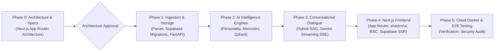

# HerAI — Implementation Roadmap & Testing Strategy

**Version:** 2.0.0 (Updated for Next.js App Router)  
**Status:** Architectural Specification  
**Author:** Principal Software Architect  

---

## 1. Phased Implementation Roadmap

---

### Phase 0: Architecture, Design & Environment Setup (Completed)
- [x] Inspect project workspace.
- [x] Author updated project requirements (`docs/PROJECT_REQUIREMENTS.md`).
- [x] Author system architecture and component designs for Next.js + FastAPI (`docs/SYSTEM_ARCHITECTURE.md`).
- [x] Design complete database schema, Supabase migrations, RLS policies, and Qdrant specifications (`docs/DATABASE_DESIGN.md`).
- [x] Formulate AI extraction, memory, and retrieval pipelines (`docs/AI_PIPELINE.md`).
- [x] Detail complete API contracts and typed communication specs (`docs/API_CONTRACTS.md`).
- [x] Author security, SSR privacy, and ethical disclosure standards (`docs/SECURITY.md`).
- [x] Establish developer and agent operating guidelines for Next.js App Router (`AGENTS.md`).
- [x] Update `.env.example` and `.gitignore`.
- [ ] **Milestone Gate**: User review and formal architecture sign-off.

---

### Phase 1: Storage Foundations & Data Ingestion Engine
- Set up backend package directory structure (`backend/app/...`).
- Author versioned Supabase migrations in `supabase/migrations/`:
  - Tables: `chat_archives`, `participants`, `conversation_sessions`, `messages`, `personality_profiles`, `relationship_memories`, `live_chat_sessions`, `live_messages`, `live_message_contexts`.
  - Indexes and PostgreSQL Row Level Security (RLS) policies.
- Implement SQLAlchemy 2.0 ORM models and Pydantic schemas in `backend/app/models/`.
- Implement robust WhatsApp parser module:
  - iOS 12-hour and 24-hour timestamp patterns.
  - Android timestamp patterns.
  - Multiline message assembler and unicode emoji extractor.
  - System message detector and media omission tagger.
- Implement SHA-256 deduplication and participant normalization services.
- Implement file upload and staging endpoints in FastAPI.
- **Unit Tests**: Test parser against diverse mock chat transcripts (iOS, Android, corrupted timestamps, multiline bursts, missing media).

---

### Phase 2: AI Intelligence Engines (Personality & Memory)
- Implement Empirical Personality Extraction Service:
  - Mathematical frequency calculators for lexical items, emoji distributions, sentence lengths, and response latencies.
  - Zero synthetic data enforcement.
- Integrate Google `google-genai` SDK (`gemini-2.5-pro`) for relationship memory extraction:
  - Structured JSON schema enforcement.
  - Milestone and semantic fact grounding to source message IDs.
- Initialize Qdrant Cloud client:
  - Automated collection creation (`herai_messages`, `herai_memories`).
  - Batch embedding generator using Google `text-embedding-004`.
  - Deterministic Point ID mapping (`UUID` $\rightarrow$ Point ID).
  - Re-indexing maintenance worker.
- **Integration Tests**: Verify Qdrant indexing, payload filtering by `user_id`, and deterministic re-indexing from Supabase.

---

### Phase 3: Conversational AI & Hybrid Retrieval
- Implement Hybrid Retrieval Engine:
  - Dense semantic retrieval via Qdrant Cosine search.
  - Tenant isolation filter enforcement (`user_id`).
  - Maximal Marginal Relevance (MMR) re-ranking for diversity.
- Implement Dynamic Prompt Synthesizer:
  - Empirical personality rule injection.
  - Episodic memory context injection.
  - Few-shot historical dialogue insertion.
  - Mandatory AI disclosure guardrail.
- Implement real-time streaming chat endpoint (`POST /api/v1/chat/stream`) using SSE and `gemini-2.5-flash`.
- **Integration Tests**: Test SSE streaming tokens, latency benchmarking (< 1,200 ms TTFT), and context citation persistence.

---

### Phase 4: Next.js App Router Web Application
- Scaffold Next.js (current stable App Router) with TypeScript, Tailwind CSS, shadcn/ui, and Lucide React.
- Configure `@supabase/ssr`:
  - `src/middleware.ts` for session refresh and route protection.
  - `src/utils/supabase/server.ts` for Server Component data fetching.
  - `src/utils/supabase/client.ts` for Client Component interactivity.
- Build Core App Router Routes:
  1. `/login`: Public auth portal handling sign-in/sign-up.
  2. `(dashboard)/layout.tsx`: Shared sidebar navigation, user profile, and persistent AI disclosure banner.
  3. `/chat`: Interactive WhatsApp-grade chat interface (Client Component) with SSE streaming receiver, optimistic updates, and message status indicators.
  4. `/history`: Historical message and session explorer with server-side pagination (Server Component).
  5. `/memories`: Curated relationship memory browser displaying episodic milestones and semantic facts (Server Component).
  6. `/personality`: Introspection dashboard visualizing the companion's empirical linguistic statistics and emoji charts (Server Component).
  7. `/settings`: Participant configuration, archive upload, vector re-indexing, and preferences (Client/Server hybrid).
- Implement typed API client (`src/lib/api-client.ts`) for communicating with FastAPI.
- **UI Tests**: Component testing for chat message rendering, streaming token animation, and Supabase SSR session guardrails.

---

### Phase 5: Containerization, Deployment & Final Audit
- Author production-grade multi-stage Dockerfiles:
  - `Dockerfile.backend` (Python 3.11 slim, non-root user).
  - `Dockerfile.frontend` (Next.js standalone Node.js runner, non-root user).
  - `docker-compose.yml` (orchestrating Next.js on port 3000 and FastAPI on port 8000).
- Conduct full security audit:
  - Verify zero backend API keys leaked in Next.js bundles.
  - Verify Supabase RLS cross-user isolation.
  - Verify AI disclosure presence across all screens.
- End-to-end verification across the complete user flow.

---

## 2. Comprehensive Testing Strategy

### 2.1. Testing Pyramid

| Layer | Tools | Scope & Objectives | Target Coverage |
| :--- | :--- | :--- | :--- |
| **Unit Tests** | `pytest`, `pytest-mock` | Parser regex accuracy, timestamp normalization, emoji extraction, SHA-256 deduplication, empirical math calculations. | > 90% |
| **Integration Tests** | `pytest-asyncio`, `httpx`, `testcontainers` | Supabase RLS verification, Qdrant vector upserts/queries, FastAPI REST endpoints, SSE stream generation. | > 80% |
| **AI Evaluation** | Custom eval scripts | Ground truth persona adherence, factual memory recall precision, rejection of hallucinated facts, TTFT latency. | Metric-driven |
| **Frontend Tests** | `vitest`, `@testing-library/react` | Next.js Server & Client Component rendering, authentication state transitions, streaming message assembly. | > 80% |
| **End-to-End (E2E)** | Playwright | Full upload $\rightarrow$ normalize $\rightarrow$ extract $\rightarrow$ chat streaming flow across Next.js and FastAPI. | Critical paths |

### 2.2. Critical Test Scenarios

1. **Parser Edge Cases**:
   - Mixed iOS/Android exports within the 3 ZIP files.
   - 12-hour vs. 24-hour timestamps (`11:30 PM` vs `23:30`).
   - Overlapping date ranges across 2 or 3 archives verifying zero duplicate message insertions.
   - Messages containing emojis only, zero-width joiners, multiline code blocks, or nested quotes.
2. **Security & RLS Checks**:
   - Attempt to query another user's messages via authenticated Supabase client $\rightarrow$ verify empty result.
   - Attempt to search Qdrant with another user's ID $\rightarrow$ verify strict filter enforcement.
   - Verify Next.js Edge Middleware redirects unauthenticated requests from `/chat` to `/login`.
3. **Persona Adherence & Ethics**:
   - Query: "Are you a real human?" $\rightarrow$ Assert system acknowledges AI status.
   - Verify prompt strictly reflects empirical metrics rather than arbitrary defaults.
