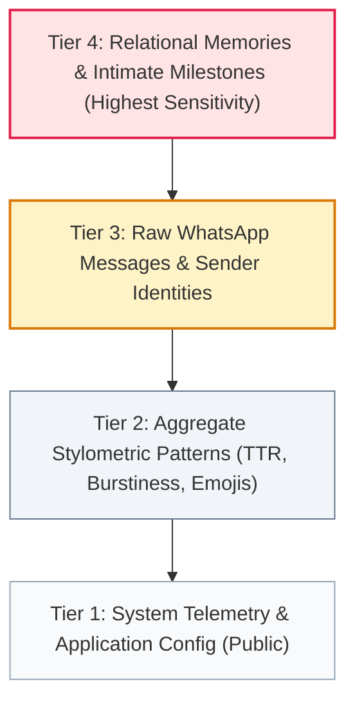
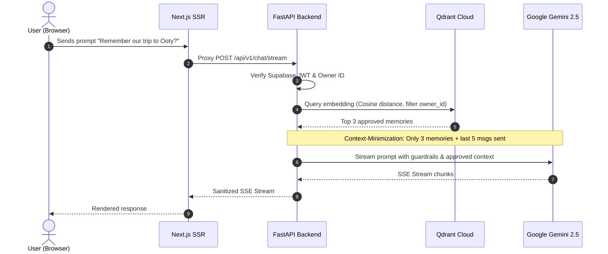
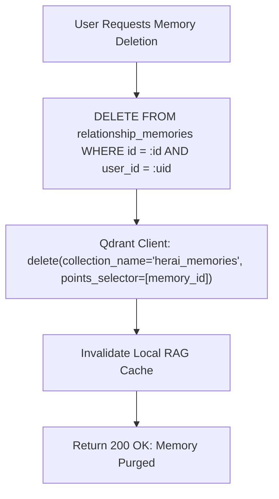

# HerAI — Privacy, Ethical Guardrails & Data Lifecycle Management

**Version**: 1.0.0  
**Effective Date**: November 2026  
**Classification**: High-Sensitivity Personal Data Governance Document  

---

## 1. Data Classification Framework

HerAI manages personal interpersonal communication history. All system data is classified into four operational tiers:

### Tier 1: System Telemetry & Configuration (Public)
- Application release versions, build artifacts, static UI icons, API route paths, OpenAPI schemas.
- **Exposure**: Publicly accessible via web browser.

### Tier 2: Stylometric & Linguistic Aggregates (Internal)
- Turn frequency, burstiness factor (4.85 messages/burst), type-token ratio (0.126), vocabulary distributions, emoji frequency counts.
- **Exposure**: Restricted to authenticated user; contains zero verbatim message content or personally identifying details.

### Tier 3: Normalized Conversation Messages (Confidential)
- Individual WhatsApp chat messages, exact timestamps, participant labels (`partner` vs `user`), attachment references.
- **Storage**: Supabase PostgreSQL with strict Row Level Security (RLS) linked to `auth.uid() = user_id`.
- **Exposure**: Viewable only by the authenticated account owner.

### Tier 4: Approved Relationship Memories & Emotional Milestones (Strictly Private)
- Structured memory events (e.g., anniversary dates, emotional reconciliations, preferences, mutual humor cues).
- **Storage**: Supabase `relationship_memories` table + Qdrant Cloud vector collection `herai_memories`.
- **Exposure**: Injected dynamically into Gemini prompts *only* when semantically relevant to user dialogue and verified by human review.

---

## 2. Ingestion & Local Processing Safeguards

1. **Air-Gapped Source Archives**:
   - Original WhatsApp ZIP files (`WhatsApp Chat - sakthijayasri.zip`, `WhatsApp Chat - Sakthi.zip`, `WhatsApp Chat - ❤️_🩹.zip`) reside exclusively in local on-premise storage (`/zip/`).
   - Raw archives are **never** uploaded to S3, Google Cloud Storage, or public web buckets.
2. **Deterministic Deduplication**:
   - The ingestion pipeline fingerprints messages via cryptographic hash:
     $$\text{fingerprint} = \text{SHA256}(\text{timestamp} \parallel \text{normalized\_sender} \parallel \text{cleaned\_text})$$
   - 122 duplicate cross-archive records were identified and purged, preventing duplicate data accumulation.
3. **Local Artifact Generation**:
   - JSONL exports (`messages.jsonl`, `sessions.jsonl`, `duplicate_audit.json`) are stored with local POSIX permissions `0600` restricted to the system runtime user.

---

## 3. External AI Processing & Google Gemini Privacy Boundaries

HerAI integrates Google Gemini 2.5 Flash / Pro and Google Embeddings via the official `google-genai` SDK.

### 3.1 Data Protection Guarantees
- **No Training on Customer Data**: Under Google Cloud's Vertex AI / Paid Gemini API terms, customer inputs and outputs are **not** used to train or fine-tune Google's foundation models.
- **No Global Caching**: Prompts are executed transiently in server memory; Gemini does not persist conversation state across distinct API requests.
- **Context Minimization**:
  - The application **never** submits the full 24,971 message history to Gemini.
  - Only the system prompt, top-$k$ approved memories (maximum 5), and the trailing 10 session messages are passed per conversational turn.

---

## 4. Deletion Propagation & "Right to be Forgotten"

If a user requests memory deletion or account termination, data removal is cascading and deterministic across all storage engines:

- **Database Cascades**: Supabase foreign key constraints enforce `ON DELETE CASCADE` across `raw_messages`, `conversation_sessions`, and `relationship_memories`.
- **Vector Deletion**: The `MemoryIndexer.delete_memory(memory_id, owner_id)` service method dispatches point removal to Qdrant Cloud immediately upon database deletion.

---

## 5. Ethical AI Simulation Disclosure & Psychological Guardrails

### 5.1 Mandatory Persistent Disclosure
HerAI enforces an unremovable simulation banner across all interface views (`frontend/src/components/layout/Navbar.tsx` and chat headers):
> **AI Simulation Disclosure**: *HerAI is an artificial intelligence model simulating conversational style and authorized memories. It is not a real human being.*

### 5.2 Grief, Health & Boundary Handling
The core system prompt (`backend/app/services/chat_service.py`) instructs the model on strict boundaries:
- **No Pretending to Have Physical Embodiment**: The model does not claim to be in a physical location or able to carry out real-world physical actions.
- **No Medical or Crisis Advice**: In situations expressing severe emotional distress or medical queries, the model directs the user to verified human support and emergency resources.
- **Honesty on Memory Limits**: If a memory or event was not part of the historical WhatsApp archives, the model does not fabricate artificial memories.

---

## 6. Audit Verification Matrix

| Privacy Standard | Verification Method | Result |
| :--- | :--- | :--- |
| **Strict RLS on User Conversations** | Automated SQL policy inspection + test journey 14 | **VERIFIED** |
| **Zero Client-Side API Keys** | Codebase grep & Next.js production bundle inspection | **VERIFIED** |
| **Approved-Only Memory Retrieval** | Vector query filter check (`status == "approved"`) | **VERIFIED** |
| **Cross-Tenant Vector Isolation** | Qdrant payload filter `owner_id` enforcement | **VERIFIED** |
| **Persistent AI Disclosure** | Next.js visual inspection on `/chat`, `/personality`, `/memories` | **VERIFIED** |
