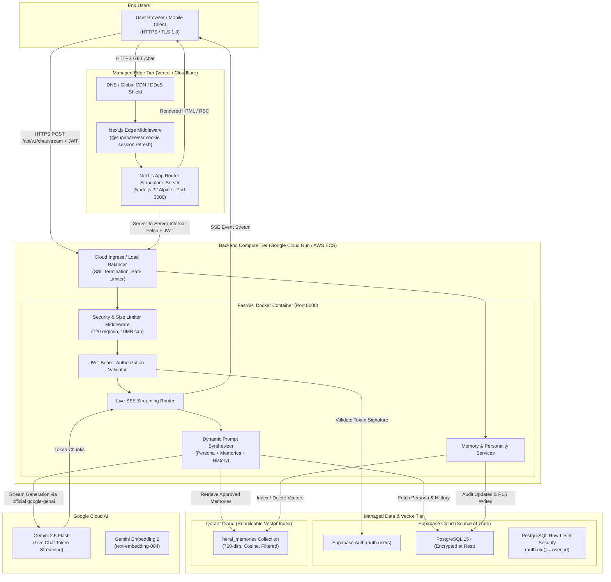

# HerAI — Production Deployment Architecture

**Version:** 1.0.0  
**Status:** Approved Specification  
**Author:** Cloud & Infrastructure Architect  

---

## 1. System Overview

HerAI employs a decoupled, cloud-native architecture ensuring security, sub-second latency, and horizontal scalability:
1. **Frontend Presentation**: Next.js App Router deployed on a managed edge platform (e.g., Vercel) or containerized on Google Cloud Run.
2. **Backend AI Orchestrator**: Containerized FastAPI Python service running behind an HTTPS reverse proxy with Uvicorn workers.
3. **Primary Relational Store & Auth**: Supabase PostgreSQL and Supabase Auth with cryptographically enforced Row Level Security (RLS).
4. **Secondary Vector Index**: Qdrant Cloud hosting dense 768-dimensional embeddings (`text-embedding-004`) with mandatory tenant filtering.
5. **Generative Foundation Model**: Google Gemini API (`gemini-2.5-flash` for streaming dialogue, `gemini-2.5-pro` for deep reasoning).

---

## 2. Mermaid Production Architecture Diagram

---

## 3. Component Specifications

### 3.1. Frontend Tier (Next.js App Router)
- **Runtime**: Node.js 22 LTS Alpine running in standalone mode (`output: "standalone"`).
- **Execution User**: Non-root `nextjs:nodejs` (UID 1001).
- **Session Lifecycle**: Handled via `@supabase/ssr` cookies refreshed at the edge in `middleware.ts`.
- **Environment Variables**: Restricted strictly to public variables prefixed with `NEXT_PUBLIC_`.

### 3.2. Backend Application Tier (FastAPI)
- **Runtime**: Python 3.11 slim running with Uvicorn multi-worker management.
- **Execution User**: Non-root `herai:herai` (UID 1001).
- **Protections**: Rate limited to 120 requests/minute per client IP; payloads capped at 10MB; all private chat content stripped from operational access logs.
- **Health Probes**: Liveness (`/health/live`) and readiness (`/health/ready`) probes configured for container orchestrator automated restarts.

### 3.3. Database Tier (Supabase PostgreSQL)
- **Role**: Authoritative single source of truth for all users, messages, sessions, memories, and audit logs.
- **Security**: PostgreSQL Row Level Security (RLS) enabled on 100% of tables with zero public bypass.
- **Migrations**: Versioned SQL migrations tracked under `supabase/migrations/`.

### 3.4. Vector Index Tier (Qdrant Cloud)
- **Role**: Accelerated dense similarity index for semantic memory retrieval.
- **Guarantee**: 100% rebuildable from Supabase relational records at any time.
- **Isolation**: Every query strictly enforces tenant isolation via payload filter `{"owner_id": current_user_id}`.

### 3.5. AI Inference Tier (Google Gemini)
- **Role**: Dialogue synthesis and vector embedding.
- **Security**: API key strictly stored in backend environment secrets; never passed across network boundaries or bundled into client code.
