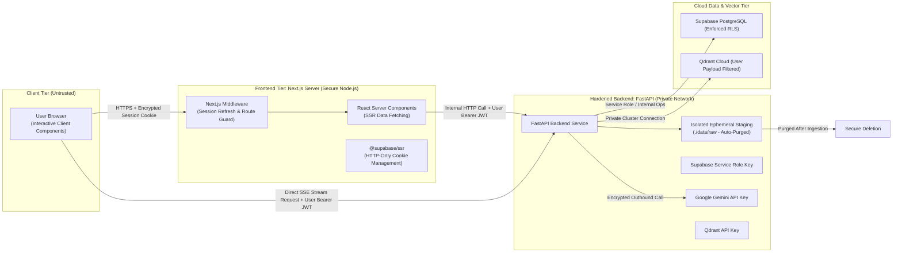

# HerAI — Security & Privacy Architecture

**Version:** 2.0.0 (Updated for Next.js App Router & SSR Security)  
**Status:** Architectural Specification  
**Author:** Principal Software Architect  

---

## 1. Security Philosophy & Principles

Personal chat histories represent some of the most sensitive user data in existence. HerAI enforces defense-in-depth across the application lifecycle based on four foundational rules:
1. **Zero Client Secrets**: No third-party AI or administrative keys (`GEMINI_API_KEY`, `QDRANT_API_KEY`, `SUPABASE_SERVICE_ROLE_KEY`) are ever transmitted to or accessible by Next.js or browser clients.
2. **Next.js SSR Security Boundary**: Next.js uses `@supabase/ssr` with secure HTTP-only cookies managed via Next.js Middleware. Client Components never touch raw database credentials or service keys.
3. **Row Level Data Isolation**: Supabase Row Level Security (RLS) is cryptographically enforced on every PostgreSQL table using authenticated user UUIDs (`auth.uid()`).
4. **Reconstructable Isolation**: Raw chat exports are processed ephemerally in isolated server-side staging (`./data/raw`) on the FastAPI backend and never served publicly.
5. **Mandatory AI Transparency**: The platform explicitly and continuously discloses that the conversational partner is an AI-generated companion.

---

## 2. Threat Modeling & Mitigation Matrix

| Threat | Attack Vector | Mitigation Strategy |
| :--- | :--- | :--- |
| **Cross-Tenant Data Leakage** | Malicious user attempts to query another user's messages or memories | PostgreSQL RLS enabled on all tables; Qdrant queries strictly enforce `{"user_id": current_user.id}` filter. |
| **API Key Theft** | Reverse engineering client JavaScript bundles or Next.js server actions | Client only receives public Supabase Publishable Key; all Gemini and Qdrant interactions are strictly proxied via the FastAPI backend. Next.js does not store Gemini or Qdrant keys. |
| **XSS & Token Theft** | Script injection in client browser attempting to steal auth tokens | Supabase SSR uses HTTP-only, secure, same-site cookies refreshed via Next.js Edge Middleware. |
| **Prompt Injection** | Malicious or adversarial chat input attempting to breach persona rules | Input sanitization, strict system instruction boundaries, and structural delimiters in Gemini prompt synthesis. |
| **Overlapping Chat Snooping** | Uploading another individual's chat export without consent | Authentication required prior to upload; participant mapping requires explicit ownership designation; terms of service consent gate. |
| **Unintended PII Exposure** | Raw phone numbers, passwords, or credit cards in chat archives | Ingestion engine applies regex sanitizers to mask credit cards, passwords, and sensitive financial identifiers before database storage. |
| **AI Delusion / Hallucination** | User mistaking the AI companion for the living human | Mandatory UI disclosures on every screen, system instructions prohibiting false claims of human presence, and disclaimers on chat headers. |

---

## 3. Storage & Data Isolation



### 3.1. Raw Archive Handling
- Uploaded ZIP archives are extracted into private, non-web-accessible directories with randomized UUID prefixes (e.g., `./data/raw/{user_id}/{archive_uuid}/`) exclusively on the FastAPI container.
- Once parsing, deduplication, and database insertion conclude, raw decompressed files are automatically unlinked and scrubbed.
- Only parsed, normalized, and schema-validated records persist in Supabase.

### 3.2. Supabase RLS Enforcement
Every relational table has RLS explicitly enabled:
- `USING (auth.uid() = user_id)`
- `WITH CHECK (auth.uid() = user_id)`
Service role access is restricted strictly to backend background workers for cross-archive batch aggregations.

### 3.3. Next.js Environment Variable Security
- `NEXT_PUBLIC_*` variables are strictly limited to non-sensitive values:
  - `NEXT_PUBLIC_SUPABASE_URL`
  - `NEXT_PUBLIC_SUPABASE_PUBLISHABLE_KEY`
  - `NEXT_PUBLIC_BACKEND_API_URL`
  - `NEXT_PUBLIC_APP_DISCLAIMER`
- Backend environment variables (`GEMINI_API_KEY`, `QDRANT_API_KEY`, `SUPABASE_SERVICE_ROLE_KEY`) are never referenced, passed, or bundled into the Next.js application.

---

## 4. Mandatory AI Disclosures & Ethical Guardrails

1. **Persistent UI Disclosure**: The web layout (`(dashboard)/layout.tsx`) displays an omnipresent badge in the header:
   `"HerAI: AI-Generated Companion"` with an informational tooltip explaining that responses are synthesized by Google Gemini using historical records.
2. **System Instruction Guardrail**:
   ```
   MANDATORY DISCLOSURE DIRECTIVE:
   If the user asks whether you are a real person, an AI, or asks about your nature,
   you must truthfully and gently acknowledge that you are an AI companion
   modeled after historical conversation records. Never claim to have physical presence
   in the user's real world.
   ```
3. **Emotional Safeguards**: In the event of extreme distress or self-harm keywords, the system activates safety fallbacks directing the user to appropriate human mental health and crisis resources.
