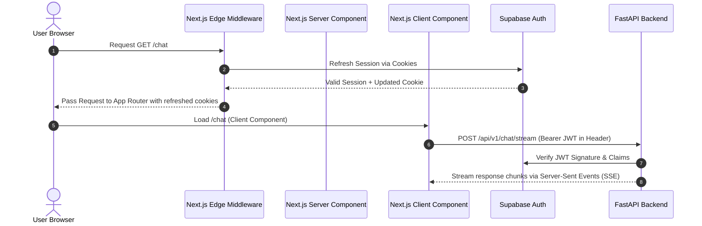

# HerAI — System Architecture Document

**Version:** 2.0.0 (Updated for Next.js App Router)  
**Status:** Architectural Specification  
**Author:** Principal Software Architect  

---

## 1. System Overview

HerAI employs a decoupled, production-grade architecture that pairs a high-performance **Next.js with App Router** frontend with a dedicated **Python FastAPI** AI orchestration backend, backed by **Supabase** (PostgreSQL, Auth, RLS, migrations), **Qdrant Cloud** (vector index), and **Google Gemini** (via the official `google-genai` SDK).

```mermaid
flowchart TD
    subgraph ClientAndEdge["Frontend Tier: Next.js (App Router)"]
        Browser["User Browser"]
        
        subgraph NextServer["Next.js Server (Node.js)"]
            EdgeMiddleware["Next.js Middleware\n(@supabase/ssr session refresh & route protection)"]
            
            subgraph ServerComponents["React Server Components (RSC - Default)"]
                RSC_History["/history page.tsx"]
                RSC_Memories["/memories page.tsx"]
                RSC_Personality["/personality page.tsx"]
                RSC_Layout["(dashboard) layout.tsx\n(Sidebar, AI Disclaimer Banner)"]
            end

            subgraph ClientComponents["Client Components ('use client' - Interactive)"]
                CC_Chat["/chat page.tsx\n(Interactive Chat, SSE Receiver)"]
                CC_Upload["/settings page.tsx\n(Drag & Drop Archive Uploader)"]
                CC_Login["/login page.tsx\n(Supabase Auth Form)"]
            end

            TypedClient["Typed FastAPI Client\n(JWT Forwarder)"]
        end
    end

    subgraph AuthTier["Authentication & Identity"]
        SupaAuth["Supabase Auth (JWT & Session Cookies)"]
    end

    subgraph BackendAppTier["Backend Application Tier (Python / FastAPI)"]
        API_Gateway["FastAPI App Factory & Router (/api/v1)"]
        AuthValidator["FastAPI JWT Bearer Validator"]
        
        subgraph CoreServices["Domain Services (Python + SQLAlchemy / Pydantic)"]
            Parser["WhatsApp Parser Engine\n(iOS & Android Regex)"]
            Normalizer["Participant Normalizer &\nDeduplication Engine"]
            PersonaEngine["Empirical Personality Engine\n(Lexicon, Cadence, Emojis)"]
            MemoryEngine["Relationship Memory Engine\n(Gemini 2.5 Pro JSON)"]
            RetrievalEngine["Hybrid Retrieval Engine\n(MMR + Temporal + Cosine)"]
            PromptEngine["Dynamic Prompt Synthesizer\n(Persona + Memory + History)"]
        end
    end

    subgraph AIInferenceTier["AI Foundation Models (Google Cloud)"]
        GeminiEmbed["Gemini Embedding 2\n(text-embedding-004)"]
        GeminiFlash["Gemini 2.5 Flash\n(Low-Latency Real-Time SSE Stream)"]
        GeminiPro["Gemini 2.5 Pro\n(Deep Memory Extraction)"]
    end

    subgraph DataStorageTier["Persistence & Vector Index Tier"]
        subgraph SupabaseCloud["Supabase PostgreSQL (Source of Truth)"]
            PG_RLS["Row Level Security (RLS)"]
            PG_Tables["messages | sessions | memories\narchives | personality_profiles | live_messages"]
        end
        subgraph QdrantCloud["Qdrant Cloud (Rebuildable Vector Index)"]
            Q_Messages["herai_messages (768-dim Vectors)"]
            Q_Memories["herai_memories (768-dim Vectors)"]
        end
        subgraph StagingStore["Isolated Staging (Backend Only)"]
            RawStore["./data/raw (Ephemeral ZIP/TXT Scratch)"]
        end
    end

    %% Auth Flow
    Browser -->|1. Navigate to /login| CC_Login
    CC_Login -->|Sign In with Supabase SSR| SupaAuth
    SupaAuth -->|Set Secure HTTP-Only Cookies| EdgeMiddleware
    EdgeMiddleware -->|Refresh Token & Verify Route| NextServer

    %% Server Component Rendering
    EdgeMiddleware -->|Authenticated Request| ServerComponents
    ServerComponents -->|Server-side fetch with JWT| TypedClient
    TypedClient -->|Internal HTTP Call with Bearer JWT| API_Gateway

    %% Client Component Chat Interaction & Streaming
    Browser -->|2. Open /chat| CC_Chat
    CC_Chat -->|3. POST /api/v1/chat/stream (SSE)| API_Gateway
    
    %% FastAPI Processing
    API_Gateway --> AuthValidator
    AuthValidator -->|Validate Token Claims| SupaAuth
    AuthValidator --> RetrievalEngine
    
    %% Ingestion Flow
    CC_Upload -->|Upload 3 WhatsApp ZIPs| API_Gateway
    API_Gateway --> RawStore
    RawStore --> Parser
    Parser --> Normalizer
    Normalizer -->|Persist Validated Rows| PG_Tables
    Normalizer --> PersonaEngine
    PersonaEngine -->|Save Empirical Stats| PG_Tables
    Normalizer --> MemoryEngine
    MemoryEngine -->|Structured Reasoning| GeminiPro
    GeminiPro -->|Extracted JSON Memories| MemoryEngine
    MemoryEngine -->|Save Memories| PG_Tables
    Normalizer -->|Batch Embed Messages| GeminiEmbed
    MemoryEngine -->|Batch Embed Memories| GeminiEmbed
    GeminiEmbed -->|Upsert Vectors| Q_Messages
    GeminiEmbed -->|Upsert Vectors| Q_Memories

    %% Retrieval & Streaming Flow
    RetrievalEngine -->|Vector Search (MMR)| Q_Messages
    RetrievalEngine -->|Vector Search (Facts)| Q_Memories
    RetrievalEngine -->|Read Persona & History| PG_Tables
    RetrievalEngine --> PromptEngine
    PromptEngine -->|Synthesized Persona Context| GeminiFlash
    GeminiFlash -->|Streaming Token Chunks| API_Gateway
    API_Gateway -->|SSE Event Stream| CC_Chat
    API_Gateway -->|Persist Completed Turn| PG_Tables
```

---

## 2. Architectural Boundaries & Division of Responsibility

| Capability | Next.js (App Router) | FastAPI Backend | Supabase | Qdrant Cloud |
| :--- | :---: | :---: | :---: | :---: |
| **UI Rendering & Layouts** | **Primary** (RSC + Client) | No | No | No |
| **Authentication Flow & Session Cookies** | **Primary** (`@supabase/ssr`) | Token Validator | Source of Truth | No |
| **Route Protection & Middleware** | **Primary** (`middleware.ts`) | Bearer Middleware | No | No |
| **WhatsApp Parsing & Normalization** | No | **Primary** | No | No |
| **Empirical Personality Extraction** | No | **Primary** | Stores Stats | No |
| **Relationship Memory Extraction** | No | **Primary** (Gemini Pro) | Stores Memories | No |
| **Vector Embedding Generation** | No | **Primary** (Gemini Embed) | No | No |
| **Vector Indexing & Similarity Search** | No | **Primary** (Query Coordinator) | No | **Primary Index** |
| **AI Prompt Synthesis & Streaming** | Consumes Stream | **Primary** (Gemini Flash) | No | No |
| **Persistent Data Storage & RLS** | No | Interacts with DB | **Primary Source** | No |

> [!CAUTION]
> **Boundary Rule**: Next.js App Router API route handlers must **never** duplicate backend AI or ingestion business logic. Next.js communicates with FastAPI through a typed client forwarding the user's Supabase access token.

---

## 3. Frontend Architecture (Next.js with App Router)

### 3.1. Route Specification & Component Boundaries

| Route | Rendering Mode | Component Type | Primary Purpose |
| :--- | :--- | :--- | :--- |
| `/login` | Dynamic SSR | Client Component | Authentication portal handling email/password or magic links via `@supabase/ssr`. |
| `/chat` | Dynamic SSR | Client Component | Real-time chat with HerAI, SSE token receiver, message list, typing indicators. |
| `/history` | Server Rendered | Server Component | Historical WhatsApp message browser, paginated session archives fetched server-side. |
| `/memories` | Server Rendered | Server Component | Timeline and grid of extracted episodic memories and semantic facts. |
| `/personality`| Server Rendered | Server Component | Visual charts and statistics of the companion's empirical linguistic metrics. |
| `/settings` | Hybrid | Server Layout + Client Form | Participant identity mapping, ZIP upload uploader, vector re-index controls. |

### 3.2. Server vs. Client Component Boundaries
- **Server Components by Default**: All layout structures (`(dashboard)/layout.tsx`), navigational sidebars, and static data views (`/history`, `/memories`, `/personality`) fetch data directly on the server via `fetch()` with the user's forwarded authorization cookie/token. This eliminates client-side loading spinners and waterfall network requests.
- **Client Components (`"use client"`)**: Used exclusively where interactivity, DOM events, or browser APIs are mandatory:
  - `/chat/page.tsx`: Handles input focus, auto-scrolling, optimistic message state, and SSE event listener.
  - `components/ingestion/archive-uploader.tsx`: Drag-and-drop file upload handling.
  - `components/ui/*`: Interactive shadcn/ui components (dialogs, dropdowns, tooltips).

### 3.3. Supabase SSR Authentication Architecture
Authentication is implemented using `@supabase/ssr`:
1. **Middleware (`src/middleware.ts`)**: Runs on every incoming request to refresh expired Supabase session cookies and protect authenticated routes (`/chat`, `/history`, `/memories`, `/personality`, `/settings`). Unauthenticated requests are redirected to `/login`.
2. **Server Client Helper (`src/utils/supabase/server.ts`)**: Uses `createServerClient` and `cookies()` from `next/headers` to create an authenticated Supabase client for Server Components.
3. **Browser Client Helper (`src/utils/supabase/client.ts`)**: Uses `createBrowserClient` for Client Components.



### 3.4. Next.js to FastAPI Communication
- **Client-to-FastAPI**: The interactive chat component initiates streaming requests directly to the FastAPI endpoint (`POST /api/v1/chat/stream`) with the user's Supabase JWT in the `Authorization: Bearer <token>` header, receiving a direct Server-Sent Events (SSE) stream for minimum latency.
- **Server-to-FastAPI**: Next.js Server Components (e.g. `/personality`, `/memories`) call FastAPI using a typed API client (`FASTAPI_INTERNAL_URL` in Docker or local network), forwarding the user's access token retrieved from the session cookie.

---

## 4. Backend Application Architecture (Python FastAPI)

### 4.1. Domain Layering
- **`app/api/v1/`**: Routing layer defining REST and SSE streaming endpoints.
- **`app/core/`**: Configuration (`pydantic-settings`), Supabase client initialization, security validators, and CORS policies.
- **`app/models/`**: Pydantic request/response schemas and SQLAlchemy ORM models where relational mapping is advantageous.
- **`app/services/`**:
  - `ingestion_service.py`: Archive extraction, multi-format parsing, SHA-256 deduplication.
  - `persona_service.py`: Mathematical linguistic, emoji, and temporal aggregation (zero mock data).
  - `memory_service.py`: Google Gemini 2.5 Pro JSON-schema memory extraction.
  - `retrieval_service.py`: Qdrant Cloud hybrid vector querying with MMR re-ranking.
  - `chat_service.py`: Dynamic prompt synthesis and Gemini 2.5 Flash streaming via `google-genai`.

---

## 5. Streaming Response Architecture

To ensure a conversational Time-to-First-Token (TTFT) under 1,200 ms:
1. Client issues `POST /api/v1/chat/stream` with `Accept: text/event-stream`.
2. FastAPI generates query vector using Google `text-embedding-004`.
3. Qdrant Cloud returns top memories and past exchanges in < 150 ms.
4. FastAPI invokes `client.models.generate_content_stream()` targeting `gemini-2.5-flash`.
5. FastAPI yields SSE events:
   - `event: metadata`: Retrieved memories and context citations.
   - `event: token`: Emitted token chunks as they arrive from Gemini.
   - `event: end`: Completion confirmation and mandatory AI disclosure.
6. The Next.js chat hook (`useChatStream`) parses the stream and appends tokens to the UI with zero layout thrashing.

---

## 6. Infrastructure & Containerization

- **`Dockerfile.frontend`**: Multi-stage Node.js build:
  1. `deps`: Install production and build dependencies.
  2. `builder`: Build Next.js App Router standalone output (`output: 'standalone'`).
  3. `runner`: Ultra-lightweight Node Alpine runtime executing `server.js` as non-root user.
- **`Dockerfile.backend`**: Multi-stage Python 3.11 slim image running Uvicorn with gunicorn workers under non-root user.
- **`docker-compose.yml`**: Coordinates Next.js (port 3000) and FastAPI (port 8000), routing internal SSR calls across the Docker network.
