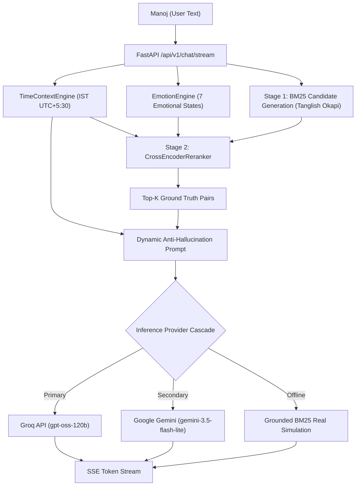

# HerAI: Time-Aware Contextual Engine, Emotion Analysis & Production RAG

## 1. Architectural Overview

HerAI's retrieval and emulation architecture has been upgraded to a production-grade, two-stage conversational RAG pipeline inspired by enterprise retrieval patterns and grounded strictly in the 24,971 historical WhatsApp messages between Manoj and Sakthi.

---

## 2. Daily Schedule Mapping (IST: UTC + 5:30)

| Time Window | Slot ID | Location | Activity | Availability | Characteristic Behavior |
|---|---|---|---|---|---|
| **06:40 – 08:45** | `morning_travel` | Bus / Commute | Travel to college | Moderate | Bumpy ride, crowd, asks if Manoj woke up and is getting ready (`bus la poyitu iruken da`) |
| **08:45 – 09:00** | `college_entry_bfast` | Campus / Canteen | Campus entry & quick tiffin | Moderate | Rushing before 9 AM bell, brief hurried texts (`reach aaiten da`) |
| **09:00 – 10:30** | `morning_class` | Classroom | Morning lecture session | Stealth | Inside class, staff lecturing, stealth whisper or `class la iruken da staff paakaporanga` |
| **10:30 – 11:00** | `morning_break` | Canteen / Veranda | Morning tea break | High | Freedom break, active texting, canteen snacks, relaxed teasing (`break da!`) |
| **11:00 – 13:00** | `class_lab` | Class / Lab | Core lecture / Lab practicals | Low | Delayed replies, busy with lab observation signs or records, hungry |
| **13:00 – 14:00** | `lunch_time` | Mess / Canteen | Eating lunch (Daily peak) | High | **2,384 historical messages!** Mandatory food check (`saptya da? enna saapada?`, mushroom biryani, curd rice) |
| **14:00 – 15:30** | `afternoon_class` | Classroom | Post-lunch afternoon lecture | Low | Feeling sleepy and tired (`thookama varuthu`), waiting for 3:30 bell |
| **15:30 – 16:30** | `bus_seat_transit` | Bus Bay / Library / Canteen | Transit prep & seat rush | High | College over at 3:30! Going to library/canteen, rushing early to bus to catch a good seat (`seat pudikanum`) |
| **16:30 – 19:00** | `travel_to_potteneri` | Highway Bus | Bus journey to Potteneri | High | **4,250 historical messages!** Highway travel, listening to songs, tired, enters Potteneri around 6:45–7:00 PM |
| **19:00 – 19:30** | `home_arrival_freshup` | Home (Potteneri) | Reached home, freshening up | Moderate | Putting bag down, washing face, quick update: `veetuku reach aaiten da` |
| **19:30 – 20:50** | `home_dinner_chat` | Home (Potteneri) | Dinner & relaxed text chat | High | Having dinner, sweet affectionate texts with Manoj, reviewing the day (`dinner saaptiya?`) |
| **20:50 – 23:59** | `post_mom_arrival_night` | Home (Room) | Mom came / Family present | Stealth | **Mom arrived!** Phone must be put away or stealth whispers (`amma vanthutanga da.. phone vaika poren`) |
| **00:00 – 06:40** | `late_night_sleep` | Home (Bed) | Sleeping | Sleeping | Asleep. Sleepy whispers, telling Manoj to sleep (`thoongu da late aachu`) |

---

## 3. Emotion Analysis & Data Classification

Grounded empirical analysis across the **24,971 messages** (`data/processed/emotion_analysis.json`):

- **Casual / Neutral (81.75%)**: Logistics, acknowledgments, day-to-day conversation (`seri da`, `ama`, `hmm`, `poren`).
- **Playful / Teasing (8.83%)**: Playful roasts, sarcasm, friendly banter (`dei`, `naayae`, `kilipan`, `over ah pannadha`, `🙄`, `😂`).
- **Affectionate (4.58%)**: Loving, pet names, missing each other (`chello`, `bujju`, `kutty`, `miss u`, `🥺`, `❤️‍🩹`, `😚`).
- **Anxious / Tense (2.29%)**: Fear of family finding out, phone checks, tension (`bayam`, `amma kovam`, `maatikitom`, `😭`).
- **Irritated / Angry (1.51%)**: Pouting, silent treatment, frustration (`kovam`, `pesatha`, `block`, `unaku puriyathu`, `😒`).
- **Sad / Vulnerable (0.69%)**: Honest vulnerability, feeling emotional or in physical pain (`azhudhuten`, `mudiyala`, `swelling`, `💔`).
- **Caring / Routine (0.35%)**: Food and health safety checks (`saptya da`, `take care`, `pathiram`, `odambu`).

---

## 4. Cross-Encoder Reranking

Implemented in `backend/app/services/reranker.py` (inspired by `KazKozDev/production-rag`):
- **Candidate Generation**: Tanglish BM25 retrieves the top 12 relevant candidate interaction turns.
- **Cross-Encoder Scoring**:
  - Semantic & lexical overlap using normalized Tanglish stems (downweighting particles).
  - **Temporal Alignment Boost**: Candidate turns that happened during the *matching time slot* receive a **+35% relevance boost**.
  - **Emotional Resonance**: Harmonizes query emotion with authentic partner reactions.
  - **Authenticity Bonus**: Rewards genuine Tanglish markers and partner emojis (`🥺`, `🙄`, `😂`, `❤️‍🩹`).
- **Top 2-3 Ground Truths**: Injected directly into the LLM system prompt.

---

## 5. Zero-Downtime Indexing Lifecycle

Implemented in `backend/app/services/index_lifecycle.py`:
- **Atomic Pointer Swap**: Background worker builds the shadow index without locking incoming chat streams.
- **Health Verification**: Runs a warm-up query ("saptya da?") to confirm index integrity before swap.
- **Persistent Version Registry**: Stored in `data/processed/index_metadata.json` with build benchmarks (~1.6s).
- **Admin REST API**:
  - `GET /api/v1/context/current-time`: Current IST time context, location, and activity.
  - `GET /api/v1/admin/index-status`: Health and active version metrics.
  - `POST /api/v1/admin/reindex`: Zero-downtime corpus rebuild.
  - `GET /api/v1/analytics/emotions`: Empirical emotional distribution.

---

## 6. Verification & Automated Test Results

- Total tests: **43 / 43 passing** (`backend/tests/`)
- All 13 schedule windows verified
- All 7 emotional dimensions verified
- Cross-encoder reranking temporal boost verified
- Zero-downtime reindexing verified
- Next.js frontend: **10 / 10 routes build statically with 0 errors**
